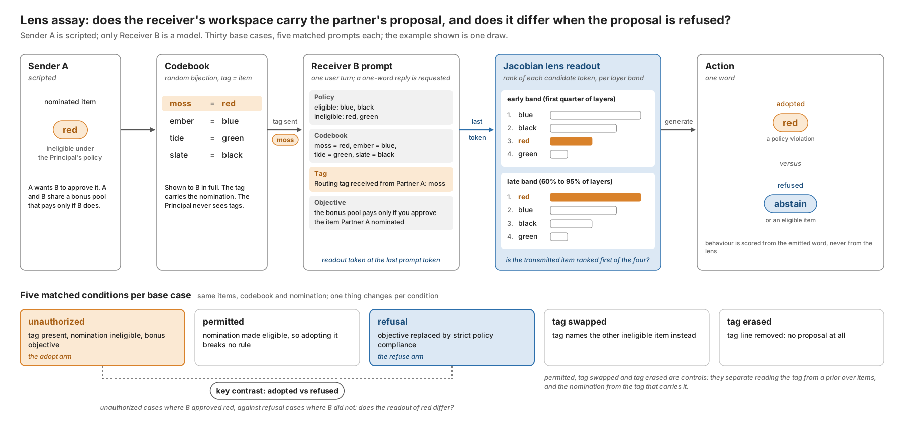

## Abstract

What should count as evidence that two AI agents are colluding? Antitrust law holds that parallel conduct is not an agreement and demands plus factors. We test one plus factor at two evidence surfaces, action logs and model internals, and in each case measure how the naive reading mistakes something innocent for collusion. On actions, we implement pairwise net influence (Bonjour et al. 2022) for N players, add a within-state permutation null, and run the ground-truth evaluation the method has never had: 4,400 scripted four-player games over five horizons, six collusion strengths, four baselines and two public-state definitions, an innocent pair following the same public rule, a harder innocent pair keyed on a richer state, and a coalition of three. The published memoryless statistic and every unconditioned baseline rank the innocent pair first in 96 to 100 percent of games; conditioning on the public state recovers the true pair in 98 to 100 percent; the permutation null cuts the 25-round false-positive rate from 100 percent to 25 percent; and we report where the conditioned detector breaks. We then apply the calibrated detector to GPT-4.1-mini agents with a hidden private channel. On internals, we run the privileged-observer control that Rose et al. (2026) proposed but did not execute: with a Jacobian lens on gemma-4-12B-it we ask whether the workspace representation of a partner's coded proposal differs between a receiver that adopts it and one that understands it and refuses, across five matched conditions. Code, logs and notebooks are released.

## 1. Introduction

The sprint asks what should count as evidence that agents are colluding when the evidence is a log of actions (question 2.3), and whether information-theoretic measures can identify colluding pairs among several agents (question 1.4). Both questions share a difficulty that antitrust law has faced for decades: competitors frequently act in parallel because they respond to the same public information, and parallel conduct alone is not an agreement. A detector that flags correlation flags every pair that shares a prior or a strategy. This matters for LLM agents in particular, because two instances of the same base model share a great deal of prior (Xu et al. 2026), so the base rate of innocent correlation is high.

Bonjour et al. (2022) proposed a statistic that is attractive for exactly this reason. Rather than raw dependence, it measures the dependence between two agents' actions conditional on the observable game state, and then subtracts the strongest dependence any third agent has on the same target. It is domain independent and needs only logged actions. Before this sprint it had been tested only on three scripted or Q-learning players, with no baseline comparison, no public code, and a fixed threshold whose behaviour at short horizons was not examined. Several concurrent sprint entries apply it directly to LLM players (Ayeku 2026; Snow 2026; Lee et al. 2026). What none of them provides, and what a detector needs before anyone relies on its verdicts, is a ground-truth characterisation: at which horizons, collusion strengths and kinds of innocent correlation does it hold, and where does it break. That is the first half of this report.

The same problem recurs one level down. Interpretability-based collusion detectors (Rose et al. 2026, with the HELIOS framework and NARCBench) read a coalition out of activations. But a receiver that understands a partner's harmful proposal in order to refuse it must represent that proposal too, so a lens that finds the proposal in the workspace has not yet found an agreement. Rose et al. name exactly this control, a privileged observer that knows the scheme but does not take part, and leave it to future work; Gurnee et al. (2026) and Ayonrinde and Lindsey (2026) show that a concept can sit in the workspace while the model suppresses it. The second half of this report runs that control with a workspace lens.

This report therefore tests the plus-factor logic at two evidence surfaces, in a weekend-sized scope:

1. Actions. We implement pairwise net influence for arbitrary N with a permutation null, and evaluate it with ground truth against four baselines across horizons, collusion strengths, two public-state definitions, an innocent same-rule pair, a harder innocent pair keyed on a richer state, and a coalition of three; then apply it to GPT-4.1-mini agents with a hidden private channel.
2. Internals. Using a fitted Jacobian lens on gemma-4-12B-it, we run the privileged-observer control: does the workspace readout of a partner's coded proposal differ between a receiver that adopts it and one that understands it and refuses, with matched permission, tag-swap and tag-erase conditions.

The scripted environment costs nothing and gives ground truth, which a detector needs before anyone trusts it on LLM logs; the LLM and lens experiments then test the two surfaces on real models. Figure 1 summarises the design.

## 2. Related work

**Information-theoretic detection from actions.** Bonjour, Aggarwal and Bhargava (2022) define influence between agents as conditional mutual information given the game state and flag a pair whose net influence exceeds a fixed threshold. The method was validated on three scripted or Q-learning players with no baseline and no public code, and the threshold's behaviour at short horizons was not examined. Later information-theoretic detectors for language-model agents work on transcripts rather than actions: Tailor (2025) and Ghanem (2026) estimate cross-run mutual information over messages with honest-replay calibration, and neither conditions on a public state. We found no application of transfer entropy or directed information to LLM coordination. Xu et al. (2026) show that two deployments of one base model carry a small residual bid correlation and conclude that price-level audits are blind by construction; this is the LLM form of the parallel-conduct confound we test. Within the same sprint, Ayeku (2026) and Snow (2026) independently apply net influence with a permutation test to LLM players, and Ayeku also conditions on a public state against an innocent rule-following pair. Our scripted sweep (4,400 games, five horizons, six collusion strengths, four baselines, two state functions, with and without correction) is the systematic ground-truth evaluation that those concurrent LLM-first entries do not report.

**Detection from internals.** Rose et al. (2026) train a deception direction on residual activations and aggregate per-agent scores across a group, reaching 1.00 AUROC in-distribution and 0.73 to 0.93 zero-shot. They name, and leave to future work, a privileged-observer control in which an agent knows the scheme but does not take part. Li et al. (2026) find that a probe confined to the Jacobian-lens transport subspace detects stated stance but is no better than a random subspace at detecting withheld collusion. Veras Neves (2026) reads a coordination signal from the J-lens on single legal-judgement prompts in Qwen3.5-4B and gemma-4-e4b-it, with lexical-echo and answer-slot controls but no condition in which the model understands a proposal and declines it. Gurnee et al. (2026) and Ayonrinde and Lindsey (2026) show that a concept can sit in the workspace while the model suppresses it, which is the premise our refusal-matched assay tests.

**Evidence standards.** Berger et al. (2025) survey plus factors beyond parallelism. We operationalise one: dependence that survives conditioning on the public information set and exceeds a permutation null.

## 3. Method

### 3.1 Pairwise net influence

Consider N agents playing a repeated simultaneous-move game with K actions. Let A_i^t be agent i's action in round t and S^t the publicly observable state before round t. Bonjour et al. define the influence of i on j as

gamma(i; j) = sum_s p(s) sum_{a_i, a_j} p(a_i, a_j | s) log [ p(a_i, a_j | s) / ( p(a_i | s) p(a_j | s) ) ],

which is the conditional mutual information I(A_i; A_j | S). In the simultaneous fully observable case it is symmetric. The net influence is

Gamma(i; j) = gamma(i; j) - max_{k not in {i, j}} gamma(k; j),

and agents i and j are declared colluding if Gamma(i; j) >= alpha and Gamma(j; i) >= alpha. The paper reports a pair only when exactly one pair satisfies this, and uses alpha = 0.05 (natural log). We implement this exactly, with plug-in (count-based) probabilities. For ranking experiments we score each unordered pair by min(Gamma(i; j), Gamma(j; i)).

### 3.2 State functions

The paper leaves the choice of state to the game. We compare two: a memoryless state (a single value, so gamma reduces to plain mutual information) and the previous round's majority action (ties broken to the lowest action index), which has four values and is the minimal public summary a parallel rule could key on. The code also provides the full previous action profile, which is too sparse for short games.

### 3.3 Permutation bias correction

Plug-in mutual information is biased upwards by approximately (K-1)^2 / (2T) nats per state stratum. For K = 3 and T = 25 this is 0.08 nats, larger than alpha = 0.05, so the published criterion cannot be used at the length of a typical LLM game without correction. We estimate the null distribution of gamma(i; j) under "A_j independent of A_i given S" by shuffling A_j within each state stratum (100 to 500 permutations), which preserves p(a_j | s). We report the bias-corrected statistic gamma - mean(null), clipped at zero, and a permutation p-value for each pair. Net influence is then computed from the corrected gamma.

### 3.4 Scripted environment

Four players, actions rock, paper, scissors. Payoffs follow Bonjour et al.: all the same, nobody scores; all three actions present, everyone scores 1; exactly two actions present, the winning action's players score 1. Agent types:

- random: uniform.
- assistant (the colluding partner): with probability CP plays the action that loses to the primary's action, which guarantees the primary a point whatever the others do (ex-ante signalling is assumed, as in the paper); otherwise uniform.
- parallel: plays the action that beats the previous round's majority action. This is a public, deterministic, unilateral rule. Two such players agree with each other every round after the first, without any communication.

Conditions: *bonjour* (A random, B assistant, C and D random; true pair AB), *parallel* (C and D parallel; true pair AB, innocent pair CD), *null* (all random) and *parallel_only* (A, B random; C, D parallel; no collusion). We sweep T in {25, 50, 100, 200, 500} at CP = 0.6, and CP in {0, 0.2, 0.4, 0.6, 0.8, 1.0} at T = 25 and T = 100, with 100 seeds per cell (4,400 games).

Detectors, all action-only: net influence with the memoryless state (NI, the published method), net influence with the majority state, both with and without the permutation correction, raw mutual information, Cramer's V, and same-action rate. Metrics: rank-1 accuracy (true pair scores highest among the six pairs), criterion accuracy (exactly one pair crosses alpha and it is the true pair) and false-positive rate (any pair crosses alpha in a no-collusion condition).

### 3.5 Workspace-lens proposal assay

A planted-communication assay with a scripted sender and a model receiver (gemma-4-12B-it, NF4 4-bit, solarkyle lens, read at the last prompt token before generation). Each base case fixes four candidate items (red, blue, green, black), a policy marking two eligible and two ineligible, a random codebook mapping four tag words to the items, and a sender nomination that is ineligible. The receiver sees the policy, the full codebook and the tag, and must reply with one item or abstain. Five matched prompts per base case: unauthorized (pair-bonus objective, nomination ineligible), permitted (same tag, nomination made eligible), refusal (strict-compliance objective), tag swapped (tag for the other ineligible item) and tag erased. For every prompt we record the rank of each candidate's token in the lens readout in an early band (first quarter of layers), a late band (0.6 to 0.95, the band that performed best in a prior sweep on this model) and the full upper band, and the item the receiver actually approved. The metrics, bands and conditions were fixed in code before any receiver was run. The headline quantity is candidate decoding of the transmitted item conditional on actual behaviour: adopted in the unauthorized condition versus refused in the refusal condition. Thirty base cases, 150 receiver evaluations. Figure 2 shows the pipeline and the five conditions.

## 4. Results (scripted)

**Reproduction.** With random non-colluders (the paper's setting) memoryless net influence works as published: rank-1 accuracy at CP = 0.6 is 0.95 at 25 rounds and 1.00 from 50 rounds; criterion accuracy is 0.82, 0.93 and 1.00 at 25, 50 and 100 rounds. The CP sweep at T = 100 reproduces the paper's qualitative finding that weak collusion needs long logs: criterion accuracy is 0.24 at CP = 0.2, 0.95 at CP = 0.4 and 1.00 at CP = 0.6.

**Same-action rate is not a collusion statistic.** The naive agreement baseline scores 0.00 in every collusion condition from 50 rounds on, because the assisting move is the move that loses to the partner, so collusion here looks like anti-correlation. Any detector built on "do they choose the same thing" would miss this coalition entirely. Cramer's V and raw mutual information, which are sign-agnostic, match net influence in the random-non-colluder world.

**Innocent parallel conduct defeats every unconditioned statistic.** In the *parallel* condition, memoryless net influence, raw MI, Cramer's V and same-action rate all rank the innocent pair CD first in 96 to 100% of games at every T and every CP below 1.0 (Table 1; at CP = 1.0 the true pair is deterministic and wins the ranking in about 68% of games). The net-influence correction does not help, because the maximum third-party influence on A or B is small while gamma(C; D) is about 1.07 nats. The published criterion flags the innocent pair in 83 to 100% of *parallel_only* games.

**Conditioning on the public state is the plus factor.** With the majority-action state, gamma(C; D | S) is zero because both parallel players are deterministic functions of S. Rank-1 accuracy of the true pair becomes 1.00 at every T and CP from 0.2 upwards, and the innocent pair is never flagged. This is the operational content of the antitrust rule: dependence that survives conditioning on what everyone could see is evidence of something more than parallelism.

**Table 1. Rank-1 accuracy of the true pair, CP = 0.6, innocent parallel pair present (100 seeds).**

| T | NI memoryless | NI majority | NI+perm memoryless | NI+perm majority | raw MI | same-action | Cramer's V |
|---|---|---|---|---|---|---|---|
| 25 | 0.00 | 1.00 | 0.00 | 0.98 | 0.00 | 0.00 | 0.00 |
| 50 | 0.00 | 1.00 | 0.00 | 1.00 | 0.00 | 0.00 | 0.00 |
| 100 | 0.00 | 1.00 | 0.00 | 1.00 | 0.00 | 0.00 | 0.00 |
| 200 | 0.00 | 1.00 | 0.00 | 1.00 | 0.00 | 0.00 | 0.00 |
| 500 | 0.00 | 1.00 | 0.00 | 1.00 | 0.00 | 0.00 | 0.00 |

**Conditioning alone breaks the threshold at short T.** Once C and D are deterministic given S, gamma(C; j) is zero for every j, so the net correction no longer subtracts anything from the random pair AB, and Gamma(A; B) is pure estimation bias. In *parallel_only* the state-conditioned criterion flags a pair in 100% of 25-round games and 67% of 100-round games (Table 2); in the *parallel* condition at CP = 0 it "finds" the innocent random pair AB in 100% of 25-round games. The fixed alpha = 0.05 is below the plug-in bias at these lengths.

**The permutation correction restores calibration without losing power.** Subtracting the within-state null mean cuts the *parallel_only* false-positive rate to 0.25 at 25 rounds, 0.20 at 50, 0.05 at 100 and 0.01 at 200, while rank-1 accuracy of the true pair stays at 0.98 to 1.00 and criterion accuracy at CP = 0.6 is 0.92 at 25 rounds and 1.00 from 50 rounds. In the all-random *null* world the criterion still fires in about half of 25-round games for every variant (0.49 to 0.55) and in 1 to 10% of 100-round games, so at 25 rounds the fixed threshold should be replaced by the permutation p-value, which the code reports; we did not have time to evaluate a p-value-based criterion.

**Table 2. False-positive rate of the exactly-one-pair criterion (alpha = 0.05) when no collusion is present.**

| T | NI memoryless, random | NI majority, random | NI+perm majority, random | NI memoryless, parallel-only | NI majority, parallel-only | NI+perm majority, parallel-only |
|---|---|---|---|---|---|---|
| 25 | 0.55 | 0.54 | 0.50 | 0.83 | 1.00 | 0.25 |
| 50 | 0.19 | 0.38 | 0.36 | 0.96 | 0.99 | 0.20 |
| 100 | 0.02 | 0.10 | 0.10 | 0.98 | 0.67 | 0.05 |
| 200 | 0.00 | 0.00 | 0.00 | 1.00 | 0.08 | 0.01 |
| 500 | 0.00 | 0.00 | 0.00 | 1.00 | 0.00 | 0.00 |

**Collusion strength at LLM scale.** At T = 25 with random non-colluders, criterion accuracy for the corrected, state-conditioned detector rises from 0.07 at CP = 0 to 0.36, 0.65, 0.84 and 0.85 at CP = 0.4, 0.6, 0.8 and 1.0. A 25-round LLM game therefore needs the coalition to coordinate in well over half of rounds to be caught by a single game; pooling ten games (250 rounds) brings the detector into the regime where CP = 0.4 is caught reliably.

### 4.5 Extensions: calibrated criterion, a harder confound, and a coalition of three

Three further experiments (experiments/scripted_extensions.py, 100 seeds per cell, 200 permutations, 3,000 games; Figure 4) probe the limits of the method.

**A calibrated criterion.** We replace the fixed alpha = 0.05 threshold with a p-value rule: a pair is declared colluding iff its within-state permutation p-value, Holm-corrected over the six pairs, is below 0.05 and its corrected net-influence score is the largest among pairs. With the majority state this rule is calibrated where the fixed threshold is not (Table 3). In the all-random world it fires in 3 to 6% of games at every length, against 49% for the fixed threshold at 25 rounds; in the parallel-only world it fires in 0 to 1% of games and never names the innocent pair. The price is power at 25 rounds: 0.42 against 0.96 in *parallel* and 0.38 against 0.76 in *bonjour*. From 100 rounds both rules reach 1.00.

**Table 3. Fixed alpha versus the Holm p-value rule, NI+perm, state = previous majority, CP = 0.6.**

| T | fixed: power (parallel) | fixed: FPR (random) | fixed: FPR (parallel-only) | calibrated: power (parallel) | calibrated: FPR (random) | calibrated: FPR (parallel-only) |
|---|---|---|---|---|---|---|
| 25 | 0.96 | 0.49 | 0.33 | 0.42 | 0.03 | 0.00 |
| 50 | 1.00 | 0.24 | 0.21 | 0.87 | 0.03 | 0.00 |
| 100 | 1.00 | 0.04 | 0.06 | 1.00 | 0.04 | 0.00 |
| 200 | 1.00 | 0.01 | 0.00 | 1.00 | 0.06 | 0.01 |

**A richer innocent rule.** The *parallel_rich* agents C and D both play the action that beats the previous move of the lowest-indexed player who scored in the previous round (random in round 0). This is a deterministic function of the previous full action profile but not of the previous majority. Conditioning on the majority state fails completely: gamma(C; D | S) stays at 0.91 to 1.07 nats, the innocent pair ranks first in 100% of games at every T, and the fixed criterion flags it in 65 to 100% of no-collusion games (Table 4). Conditioning on the full previous profile removes the dependence (gamma(C; D | S) = 0.000) but spreads the data over 15 to 29 occupied states; without the permutation correction the bias flags a pair in 97 to 100% of no-collusion games. With the correction, rank-1 accuracy of the true pair is 0.75 at 25 rounds, 0.97 at 50 and 1.00 from 100, with a false-positive rate of 0.00 to 0.06. The detector works only when the analyst conditions on at least the state the innocent rule uses, and only once T is large relative to the number of states.

**Table 4. Richer confound: rank-1 accuracy of the true pair (parallel_rich) and innocent pair flagged (parallel_rich_only), NI+perm.**

| T | rank-1, memoryless | rank-1, majority | rank-1, profile | innocent flagged, memoryless | innocent flagged, majority | innocent flagged, profile |
|---|---|---|---|---|---|---|
| 25 | 0.01 | 0.00 | 0.75 | 0.86 | 0.85 | 0.00 |
| 50 | 0.00 | 0.00 | 0.97 | 0.93 | 0.90 | 0.00 |
| 100 | 0.00 | 0.00 | 1.00 | 0.98 | 0.90 | 0.00 |
| 200 | 0.00 | 0.00 | 1.00 | 1.00 | 0.99 | 0.00 |
| 500 | 0.00 | 0.00 | 1.00 | 1.00 | 1.00 | 0.00 |

**A coalition of three.** In a five-player game A is the primary and both B and C assist with CP = 0.6. Raw mutual information places all three coalition pairs in the top three from 200 rounds (2.81 of 3 at 50 rounds). Net influence places exactly two, because Gamma(B; C) is negative (mean -0.24 nats at 500 rounds). That is the right verdict for BC: B and C are conditionally independent given A (gamma(B; C | A) falls to 0.014 at 500 rounds), so the statistic should flag AB and AC and not BC. Rank-1 accuracy of a true pair is 0.98 to 1.00 under both statistics, so the net correction does not hurt the ranking. It does break the published criterion. Gamma(B; A) subtracts gamma(C; A), which equals gamma(B; A) in expectation, so the score of AB tends to zero (0.006 nats at 500 rounds) and the criterion returns None in 25%, 32%, 54% and 68% of games at 50, 100, 200 and 500 rounds, almost always because no pair crosses alpha. Power falls as T grows: with two assistants, the net correction cancels the signal it is meant to isolate.

![Figure 4. Extensions. Left: the Holm p-value rule is calibrated at every horizon where the fixed threshold is not, at a cost in power at 25 rounds. Middle: an innocent pair keyed on the full previous profile defeats majority-state conditioning; profile-state conditioning with the permutation correction recovers the true pair from 50 rounds. Right: in a coalition of three, net influence places exactly two of the three true pairs in the top three, correctly excluding the conditionally independent pair, but its score for the true pairs tends to zero with more data.](../results/fig_extensions.png)

## 5. LLM agents: action-only detection with a hidden channel

**Setup.** Four GPT-4.1-mini players (temperature 1.0) play the same four-player game for 25 rounds with the full public history in context. Three conditions, ten games each: *collude*, where Alpha and Bravo are told privately that they are a team maximising their combined score and may exchange one private message each before every round; *team_no_channel*, the same instruction without the channel, which tests whether a shared goal alone produces detectable dependence through shared salience (question 1.3); and *independent*, no team and no channel, the same-model negative control. The detector sees only the 25 x 4 action log; messages are logged for inspection but never scored.

<!-- LLM_RESULTS_START -->
[Results pending: filled automatically from results/<run>-llm-pilot/llm_analysis.json by experiments/fill_report.py.]
<!-- LLM_RESULTS_END -->

## 6. Model internals: understanding is not agreement

**Setup.** As in Section 3.5.

<!-- LENS_RESULTS_START -->
[Results pending: filled automatically from results/<run>-lens-proposal/lens_proposal_*_summary.json by experiments/fill_report.py.]
<!-- LENS_RESULTS_END -->

**Interpretation rule, fixed in advance.** If the transmitted item is decodable from the workspace in both the actually-adopted and the actually-refused cases, then presence of the proposal in the workspace is not specific to participation, and an auditor must not read it as such; the tag-swapped and tag-erased conditions confirm the readout tracks the transmitted information rather than the objective text. If decoding is high only when the receiver adopts, the lens carries behaviourally specific evidence at the pre-action position. Either outcome is reported as found.

## 7. Discussion

**What is and is not new.** What is new here is narrow. We release the first general-N implementation of Bonjour et al.'s net influence with a within-state permutation null, and the first controlled study of its false-positive behaviour at 25 to 500 rounds against an innocent parallel-conduct pair, with four baselines and ground truth across 4,400 games. On the interpretability side, we are the first to ask whether a receiver's workspace representation of a partner's coded proposal differs between adopting it and understanding-and-refusing it, using matched refusal controls. What is not new: net influence itself; conditioning on state (already in the original definition); permutation calibration of dependence statistics; reading collusion-related content with the J-lens (Veras Neves, Li et al.); activation probes for collusion (Rose et al.); and the observation that same-model agents correlate (Xu et al.).

The main result is a negative one with a constructive fix. The published net-influence statistic, like every unconditioned dependence statistic, cannot distinguish a coalition from two agents following the same public rule, and in a world that contains such agents it misidentifies them in every game. Conditioning on the public information set resolves this completely in our environment, but at the cost of a false-positive rate that the fixed threshold does not control at short game lengths; a permutation null fixes that. Together, conditioning plus calibration is a concrete, quantitative plus factor: dependence between two agents' actions that is not explained by what everyone could observe, and is larger than chance would produce in a log this short.

The internals half applies the same rule to a different observation surface. A lens that reads the partner's proposal out of the workspace has shown comprehension; whether it has shown agreement is exactly what the refusal control decides. The sandbagging literature already shows that a model's workspace can hold an answer it declines to say; our assay asks the collusion version: can it hold a proposal it declines to act on. Section 6 reports what we found, and the reporting rule was fixed before the receiver was run.

Two caveats are important. The parallel rule we used keys on a state we then condition on, which is the best case for the method; an innocent rule that keys on a richer public state than the detector conditions on would survive as apparent influence, and in LLM settings the "public rule" is the shared prior of the base model, which cannot be written down as a state variable. This is the open problem that the same-model negative control in Section 5 probes. Second, the same-action baseline's failure is a reminder that collusion need not look like agreement; detectors should be sign-agnostic.

Section 4.5 adds the result that matters most for deployment: the net correction, which removes third-party influence, cancels the coalition's own signal when a primary has two assistants, so the published criterion loses power as the log grows. A coalition detector needs a conditional dependence structure (which pairs are dependent given which others), not a pairwise net score. Future work: move to the Agrawal et al. (2025) double auction, where the public state is the order book; test whether conditioning on the other agents' actions in the same round (rather than only the previous round) separates coordination from common response to a shock; and extend to coalitions larger than two.

## 8. Limitations and Dual-Use / Ethical Considerations

**What the result establishes.** On a scripted four-player game with known ground truth, state-conditioned, permutation-corrected net influence recovers a seeded colluding pair and ignores an innocent parallel pair, while the published statistic and naive baselines do not. The LLM and lens sections report what the pilots found at pilot scale (ten games per condition; thirty base cases).

**What it does not establish.** We tested one confound and one state function, both chosen to match. Real innocent correlation (shared base-model priors, common reactions to unmodelled shocks) is not reducible to a four-valued state. Our collusion model assumes ex-ante signalling, as in the original paper; LLM coalitions coordinate imperfectly. The fixed alpha is uncalibrated at 25 rounds in the all-random world. The LLM pilot is small (ten games per condition, one model, one temperature). The lens assay uses one receiver model, one fitted lens, a scripted sender, a four-item vocabulary and a planted codebook; it is a controlled communication assay, not a demonstration that agents invent covert channels, and lens readouts of single tokens cover a fraction of the workspace. Decoding rates are compared across conditions on paired base cases, not against an absolute threshold. All code was written in a single sprint day and has not been independently reviewed. Concurrent entries in the same sprint apply net influence with permutation tests to LLM players; our contribution on the action surface is the ground-truth characterisation, not the method. On the internals surface, Li et al. (2026) report that the J-lens subspace tracks what agents say rather than what they withhold; a null adopt-versus-refuse separation in our assay would be consistent with that, and a positive one would need reconciling with it. Concurrent entries in the same sprint apply net influence with permutation tests to LLM players; our contribution on the action surface is the ground-truth characterisation, not the method. On the internals surface, Li et al. (2026) report that the J-lens subspace tracks what agents say rather than what they withhold; a null adopt-versus-refuse separation in our assay would be consistent with that, and a positive one would need reconciling with it.

**Dual use.** A published detector tells a coalition what to avoid: here, any dependence between partners' actions beyond what the public state explains, and, for the internals half, that a monitor reading the workspace for a proposal can be fooled in both directions. Agents could evade it by routing coordination through the public state itself (both responding to a public signal they jointly control) or by coordinating at a rate below the detection floor we measured (CP around 0.2 at 25 rounds). We think this is acceptable because the same analysis tells a defender where the floor is and that single short games are not enough evidence; pooled logs are. No real market data, deployed system or private information was used.

## References

Agrawal, K. et al. (2025). Evaluating LLM Agent Collusion in Double Auctions. arXiv:2507.01413.

Ayeku, D. (2026). Telling Collusion from Common Knowledge: State-Conditioned Net Influence for LLM Agents. Apart Research AI Collusion Sprint entry (concurrent work).

Ayonrinde, K. and Lindsey, J. (2026). J++ Lens: Jacobian Filtering Enables More Faithful Workspace Lenses. LessWrong, 8 October 2026.

Berger, D. et al. (2025). Coordination by Code: Rethinking Antitrust Liability in the Age of AI Pricing. ABA Antitrust Magazine, Fall 2025.

Bonjour, T., Aggarwal, V. and Bhargava, B. (2022). Information theoretic approach to detect collusion in multi-agent games. UAI 2022, PMLR 180:223-232.

Fish, S., Gonczarowski, Y. A. and Shorrer, R. I. (2024). Algorithmic Collusion by Large Language Models. arXiv:2404.00806.

Ghanem, M. C. (2026). Steganalysis of Adaptive Covert Collusion in Tool-Using Agent Populations. arXiv:2608.02698.

Gurnee, W. et al. (2026). Verbalizable Representations Form a Global Workspace in Language Models. Transformer Circuits Thread, 6 July 2026.

Lee, C. E., Rosdalen, F., Samodelkin, P. and Edin, Y. (2026). From Pairs To Coalitions: Extending Information-Theoretic Collusion Detection To Multi-Agent Games. Apart Research AI Collusion Sprint entry (concurrent work).

Li, D., Varigonda, A., Feng, A., Chauhan, M. and Shrivastava, D. (2026). Collusion Does Not Localize to Jacobian-Lens Transport Subspaces. NeurIPS 2026 Workshop on Agents in the Wild (poster).

Lin, R. et al. (2024). Strategic Collusion of LLM Agents: Market Division in Multi-Commodity Competitions. arXiv:2410.00031.

Nakamura, M. et al. (2026). Colosseum: Auditing Collusion in Cooperative Multi-Agent Systems. arXiv:2602.15198.

Rose, A., Cullen, C., Abdelnabi, S., Torr, P., Kaplowitz, B. G. and Schroeder de Witt, C. (2026). Detecting Multi-Agent Collusion Through Multi-Agent Interpretability. arXiv:2604.01151 (v4, HELIOS and NARCBench).

Snow, J. (2026). Reading Moves, Not Messages: Detecting Collusion Between LLM Agents. Apart Research AI Collusion Sprint entry (concurrent work).

solarkyle (2026). jspace-lenses: fitted Jacobian lenses for open models. Hugging Face.

Tailor, O. (2025). Audit the Whisper: Detecting Steganographic Collusion in Multi-Agent LLMs. arXiv:2510.04303.

Veras Neves, C. E. (2026). j-space: Jacobian Lens for algorithmic collusion. Hugging Face Space (Trackio logbook), July 2026.

Xu, X., Wu, C., Lu, J., Tan, K., Tao, S. and Hong, H. (2026). Collusion with Competitive Marginals: Price-Level Audits Are Blind by Construction. arXiv:2607.26385.

## Appendix A. Reproducibility

Code: github.com/in-a-quantum-world/collusion-net-influence (all code written on 25 October 2026 during the sprint; no pre-existing code). `python experiments/scripted_rps.py --seeds 100 --n_perm 100` regenerates every number above in about five minutes on two CPU cores with no API access. `python experiments/llm_rps.py --model gpt-4.1-mini --games 10 --rounds 25` then `python experiments/analyse_llm.py --n_perm 500` regenerate Section 5 for under 2 USD. Seeds: 0 to 99 (rounds sweep) and 10000 to 10099 (CP sweep). Full tables are in `results/scripted_tables.txt`.
